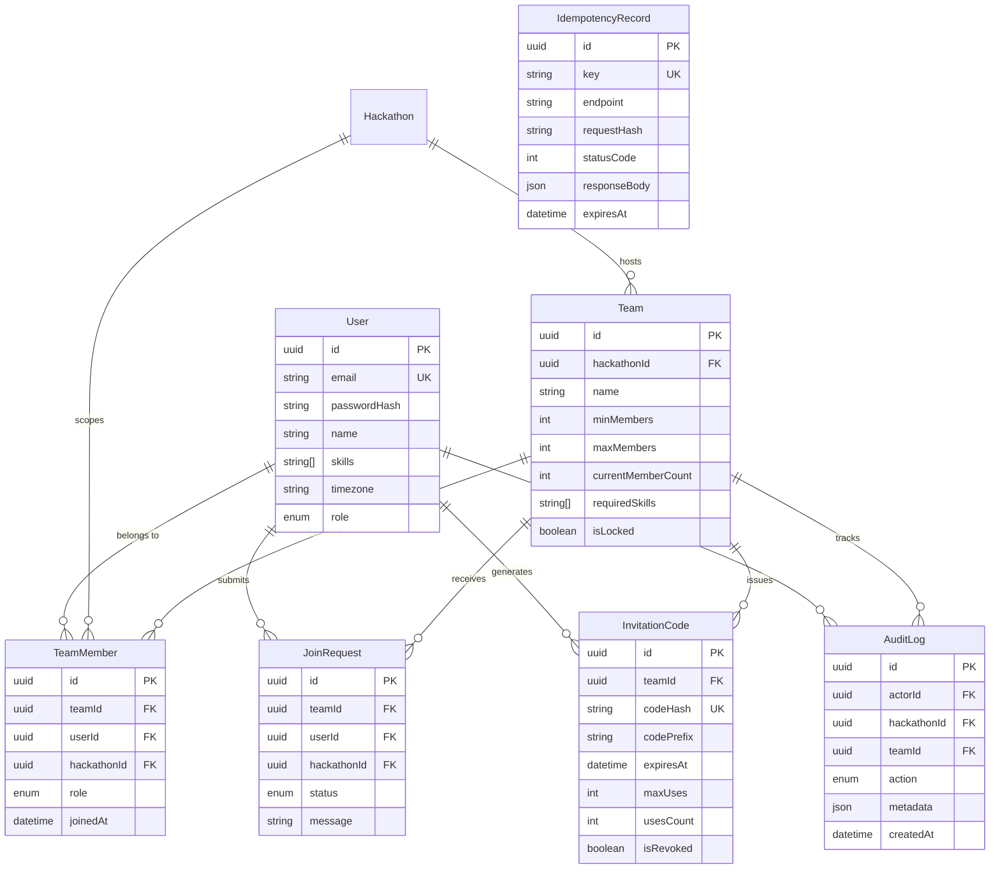

# TeamForge — Engineering Design Document
**System Architecture & Concurrency Correctness Specification**  
*PS1 Challenge: Race-Proof Team Formation at Scale (10,000+ Participants)*

---

## 1. Executive Summary & Problem Formulation
In high-throughput hackathons with thousands of participants, team capacity contention is a classic distributed concurrency vulnerability. When 50 participants simultaneously attempt to claim the final open seat in a team of capacity 5, naïve read-then-write architectures (`count < max ? insert : reject`) suffer from write-skew race conditions where multiple requests pass the capacity check simultaneously, leading to database overfill, duplicate memberships, and corrupted states.

TeamForge solves this through a multi-layered defense-in-depth architecture:
1. **Pessimistic Row-Level Locking (`SELECT ... FOR UPDATE`)** serializing critical capacity transitions inside strict PostgreSQL transactions.
2. **Database-Level Composite Constraints (`UNIQUE(userId, hackathonId)`)** guaranteeing single-team invariants regardless of application-level bugs.
3. **Idempotency Keys (`Idempotency-Key` header with SHA-256 payload hashing)** ensuring network retries cannot produce duplicate operations.
4. **Post-Commit Real-Time Notifications** ensuring WebSocket clients only receive authoritative, committed state updates.

---

## 2. Data Model & Constraint Topology



### Critical Database Constraints:
- `TeamMember(userId, hackathonId) UNIQUE`: Mathematically enforces across PostgreSQL storage engine that a participant cannot belong to multiple teams in the same tournament.
- `TeamMember(teamId, userId) UNIQUE`: Prevents duplicate membership in a single team.
- `Team(hackathonId, name) UNIQUE`: Prevents naming collisions within tournaments.
- `InvitationCode(codeHash) UNIQUE`: Stores cryptographically hashed SHA-256 tokens.

---

## 3. Concurrency Strategy: Pessimistic vs Optimistic Locking

### Why Pessimistic Locking (`SELECT FOR UPDATE`) was chosen over OCC:
- **Optimistic Concurrency Control (OCC)** relies on a version column (`WHERE id = :id AND version = :v`). Under heavy contention (e.g. 50 simultaneous join requests for 1 seat), OCC results in 49 write-skew collision rollbacks. If client retries are triggered, this unleashes an exponential retry storm (thundering herd problem), pegging database CPU and exhausting connections.
- **Pessimistic Locking (`SELECT FOR UPDATE`)** serializes access to the `Team` row at the PostgreSQL lock manager. Transaction 1 acquires `RowExclusiveLock`, validates `currentMemberCount < maxMembers`, increments the counter, writes the audit log, and commits in ~2ms. Transactions 2 through 50 queue safely. When Transaction 2 acquires the lock, it immediately reads `currentMemberCount == maxMembers`, raises `TeamFullError` (HTTP 409), and aborts. Transactions 3–50 evaluate in sequence with zero wasted write collisions and zero retry storms.

```mermaid
sequenceDiagram
    autonumber
    actor U1 as Racer 1 (Fastest)
    actor U2 as Racer 2 (Concurrent)
    actor U50 as Racer 50 (Concurrent)
    participant DB as PostgreSQL Engine (TeamForge)

    Note over U1,U50: Team has 4 members; Max capacity = 5 (1 seat left)
    U1->>DB: BEGIN Tx1; SELECT * FROM "Team" WHERE id = $1 FOR UPDATE
    U2->>DB: BEGIN Tx2; SELECT * FROM "Team" WHERE id = $1 FOR UPDATE
    U50->>DB: BEGIN Tx50; SELECT * FROM "Team" WHERE id = $1 FOR UPDATE

    Note over DB: Tx1 acquires Exclusive Row Lock. Tx2...Tx50 BLOCK at DB level.
    DB-->>U1: Lock Granted (currentMemberCount = 4 < 5)
    U1->>DB: INSERT TeamMember; UPDATE Team SET count = 5; COMMIT
    DB-->>U1: 200 OK (Member Joined!)

    Note over DB: Lock passes to Tx2. Tx2 unblocks and reads committed state.
    DB-->>U2: Lock Granted (currentMemberCount = 5 >= 5)
    Note over DB: Capacity check fails! Tx2 rolls back immediately.
    DB-->>U2: 409 Conflict (TeamFullError)

    Note over DB: Lock passes sequentially to Tx3..Tx50
    DB-->>U50: Lock Granted (currentMemberCount = 5 >= 5) -> ROLLBACK
    DB-->>U50: 409 Conflict (TeamFullError)
```

---

## 4. Idempotency Engine Architecture
To handle flaky mobile network disconnects and retried HTTP requests without duplicate mutations:
1. Client generates header: `Idempotency-Key: idemp_<random>_<timestamp>`.
2. Middleware computes `requestHash = SHA256(req.body)`.
3. If `IdempotencyRecord` exists:
   - If stored `requestHash !== requestHash`: returns **422 Unprocessable Entity** (rejecting key reuse with altered payload).
   - If matches: returns stored response with header `X-Cache-Lookup: HIT-IDEMPOTENT` without re-executing.
4. If new: Request executes. Upon successful 2xx response, result is persisted with a 24-hour TTL. Failed requests (5xx) do not lock the key, allowing clean retries.

---

## 5. Teammate Recommendation Algorithm
The recommendation engine calculates a transparent, deterministic matching score between an open team and unassigned participants:

$$\text{Total Score} = 0.60 \times \text{Skill Score} + 0.40 \times \text{Timezone Score}$$

1. **Skill Complementarity (60%)**:
   - $R = \text{Required Skills}$, $E = \text{Skills already present in team members}$.
   - $N = R \setminus E$ (Missing skills the team urgently needs).
   - Candidate covering missing skills receives a 60% priority weight bonus.
2. **Timezone Compatibility (40%)**:
   - $\Delta T = \min(|T_{\text{candidate}} - T_{\text{team}}|, 24 - |T_{\text{candidate}} - T_{\text{team}}|)$.
   - $\text{Timezone Score} = \max(0, 100 - (\Delta T \times 8.33))$.
   - Candidates within 1 hour difference score 100%; candidates 12 hours apart score 0%.
3. **Strict Invariant Filter**: Candidates already belonging to a team or having active requests are filtered out.

---

## 6. Deterministic Leadership Succession
When a team leader departs:
1. Lock team row with `SELECT FOR UPDATE`.
2. Query remaining members ordered deterministically: `SELECT * FROM "TeamMember" WHERE teamId = $1 ORDER BY "joinedAt" ASC`.
3. If `members.length == 1`: Delete team (or archive per retention policy) and record `TEAM_DELETED`.
4. If `members.length > 1`: The member with the earliest `joinedAt` timestamp is promoted to `LEADER`. The departing leader row is deleted, count decremented, and `LEADER_TRANSFERRED` audit log emitted.

---

## 7. Performance & Latency Optimizations
- **Composite Covering Indexes**:
  - `Team(hackathonId, currentMemberCount)`: Allows index-only scans for open seat queries (`WHERE currentMemberCount < maxMembers`).
  - `Team(hackathonId, createdAt DESC)`: Accelerates paginated discovery boards.
  - `JoinRequest(teamId, status)`: Fast filtering of pending join requests.
- **Connection Pool Tuning**: Prisma connection pooling configured with optimal timeouts (`pool_timeout=10`) preventing socket starvation during concurrent surges.

---

## 8. What Would Be Improved With One Additional Week
1. **Distributed Lock Optimization**: Introduce Redis-backed distributed locks (`Redlock`) with token bucket rate-limiting at the ingress edge for global multi-region deployments.
2. **Transactional Outbox Worker**: Run a dedicated background worker polling the outbox table via PostgreSQL `LISTEN / NOTIFY` to decouple WebSocket fan-out from transaction commits.
3. **Advanced Skill Embeddings**: Replace Jaccard skill matching with vector embeddings (e.g. pgvector) to recognize semantic skill synonyms (e.g. "K8s" = "Kubernetes", "Postgres" = "PostgreSQL").
4. **Chaos Engineering Harness**: Integrate automated network partition testing (Jepsen-style) to verify partition tolerance under split-brain network failures.

